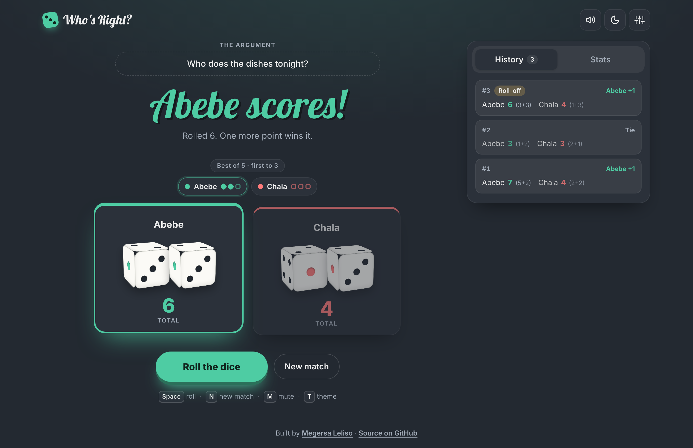

<div align="center">

# 🎲 Who's Right?

**Settle any argument with a provably fair roll of the dice.**

[](https://github.com/MegersaLeliso/Who-is-right-/actions/workflows/ci.yml)


[](LICENSE)

[**▶ Live demo**](https://megersaleliso.github.io/Who-is-right-/)



</div>

---

## About

Two friends can't agree who does the dishes. Type the argument, name the players, and roll. The dice decide.

The project started as the classic "Dicee" exercise: refresh the page and two dice images change. I rebuilt it from scratch as a complete, polished web app. The game logic is a pure, unit-tested module, the dice are real 3D objects drawn in CSS, and the app uses no frameworks, libraries or build step.

## Features

| | |
|---|---|
| 🎲 **3D CSS dice** | Each die is a six-sided cube built with CSS 3D transforms. Dice tumble to the rolled face with a physics-style bounce. No images involved. |
| 👥 **2–4 players, 1–3 dice each** | Each player gets their own colour. Click a name to edit it. With multiple dice, totals are summed. |
| 🏆 **Match modes** | Single roll, best of 3, 5 or 7, or open-ended free play, with a live scoreboard. |
| ⚔️ **Roll-offs** | When the highest total is tied, only the tied players roll again. Everyone else sits out until it's decided. |
| 🔐 **Fair randomness** | Rolls come from `crypto.getRandomValues` with rejection sampling, so there is no modulo bias. |
| 📊 **Live stats** | Wins, win %, average roll, best roll and longest streak, plus a face-distribution chart and a **chi-square fairness test** on every die rolled. |
| 🕓 **Match history** | Every round, with individual dice, roll-off tags and results. |
| 🔊 **Synthesised sound** | The dice rattle, point chime and fanfare are generated live with the Web Audio API, so there are no audio files. Can be muted. |
| 🎉 **Celebrations** | A hand-written canvas confetti system and a winner dialog with **Share result** (Web Share API, or clipboard as a fallback). |
| 💾 **Persistence** | Settings and the match in progress survive a page reload (`localStorage`, validated on load). |
| ↩️ **Undo** | Started a new match by accident? Undo it from the toast. |
| 🌗 **Light & dark themes** | Follows your OS setting by default. A manual override is remembered, and the theme is applied before first paint so the page never flashes. |
| ♿ **Accessible** | Results are announced through a live region. Includes keyboard shortcuts, native `<dialog>` focus handling, ARIA tabs, a skip link, visible focus rings and `prefers-reduced-motion` support. |
| 📱 **Responsive** | Designed for phones through to wide desktops. |

### Keyboard shortcuts

| Key | Action |
|---|---|
| <kbd>Space</kbd> / <kbd>Enter</kbd> | Roll |
| <kbd>N</kbd> | New match |
| <kbd>M</kbd> | Mute / unmute |
| <kbd>T</kbd> | Toggle theme |
| <kbd>←</kbd> <kbd>→</kbd> | Switch between History and Stats tabs |

## Getting started

No install or build step is needed.

```bash
git clone https://github.com/MegersaLeliso/Who-is-right-.git
cd Who-is-right-
open index.html          # or double-click it
```

You can also serve it locally with `npm start` (uses Python's built-in server), then visit <http://localhost:8000>.

### Running the tests

The game engine is covered by unit tests using Node's built-in test runner, so nothing needs to be installed:

```bash
npm test
```

GitHub Actions runs the tests on Node 20 and 22 for every push and pull request.

## How it works

```
index.html          markup, dialogs, ARIA structure
css/styles.css      design tokens, themes, 3D dice, responsive layout
js/game.js          pure game engine (no DOM) — shared by browser and tests
js/effects.js       Web Audio sound synthesis + canvas confetti
js/app.js           UI controller: rendering, animation, persistence, input
tests/game.test.js  unit tests for the engine
```

### A pure, immutable game engine

All the rules live in [`js/game.js`](js/game.js). Each function takes a match state and returns a **new** one; nothing is mutated:

```js
let match = createMatch({ names: ['Abebe', 'Chala'], target: 3, diceCount: 2 });
match = playRound(match);   // → { scores, rounds, contenders, champion, ... }
```

This design pays off in several ways:

- **Testable.** A seeded `rng` can be injected, so tests can force exact dice (`riggedDice(6, 6, 2)`) and check tie handling, roll-offs and match endings with certainty.
- **Easy to persist.** The whole state is plain JSON. It goes straight into `localStorage`, and `isValidMatch` rejects corrupted or outdated data on load.
- **Cheap undo.** Undoing a new match just restores the previous state object.
- **Simple UI.** [`js/app.js`](js/app.js) only translates the state into DOM updates.

The engine uses a small UMD wrapper. It loads as a plain `<script>` in the browser, so it works even when opened from `file://`, and loads via `require()` in Node.

### Unbiased dice

`Math.random() * 6` is fine for a toy, but a die decides who's *right* here. Rolls use the Web Crypto CSPRNG. Taking a 32-bit random number modulo 6 slightly favours low faces, because 2³² isn't divisible by 6. To avoid that, values from the uneven top of the range are rejected and redrawn:

```js
const limit = 2 ** 32 - (2 ** 32 % max);
do crypto.getRandomValues(buf); while (buf[0] >= limit);
return (buf[0] % max) + 1;
```

The Stats tab lets anyone check this. After 30 dice, it runs a **Pearson chi-square goodness-of-fit test** against a uniform distribution and reports whether the results are consistent with fair dice. The test suite runs the same check over 60,000 rolls.

### 3D dice in CSS

Each die is a `preserve-3d` cube with six faces. Each face is a 3×3 CSS grid of pips. To show a value, the cube rotates by that face's rotation plus one or two extra full turns on each axis. The full turns are invisible in the final position, but they make the die tumble on the way there. The rotation always moves forward from the cube's current angle, so every roll spins the same direction.

## Roadmap ideas

- Online multiplayer rooms (WebSockets) so friends can roll from their own phones
- Installable PWA with offline support
- Custom dice (d4, d8, d20) and "lowest roll wins" mode
- Shareable result cards rendered to an image

## Author

**Megersa Leliso** · [GitHub](https://github.com/MegersaLeliso)

Released under the [MIT License](LICENSE).
